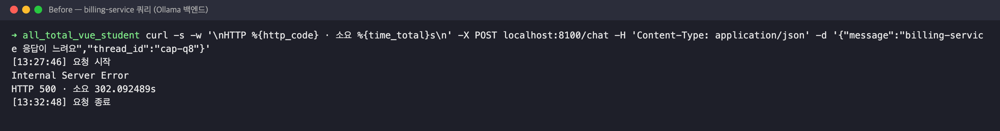
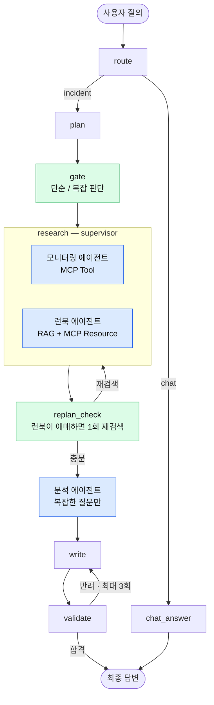
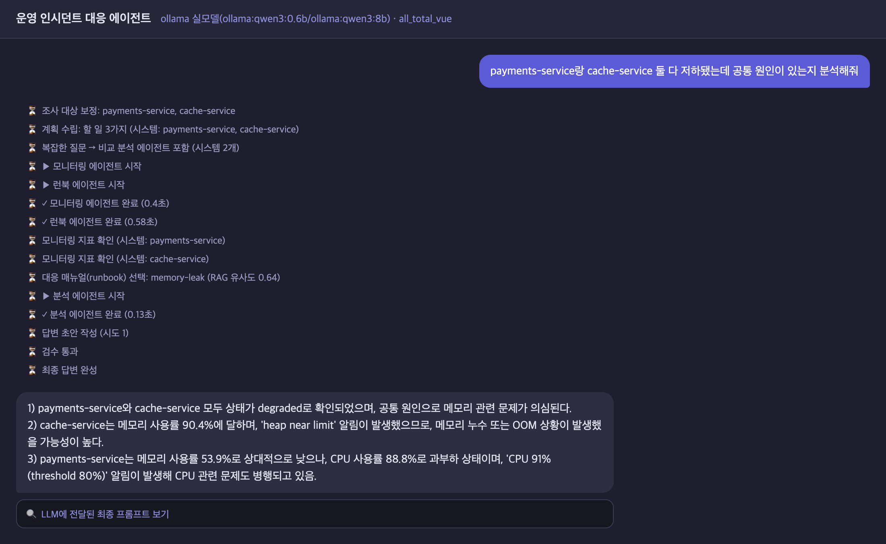
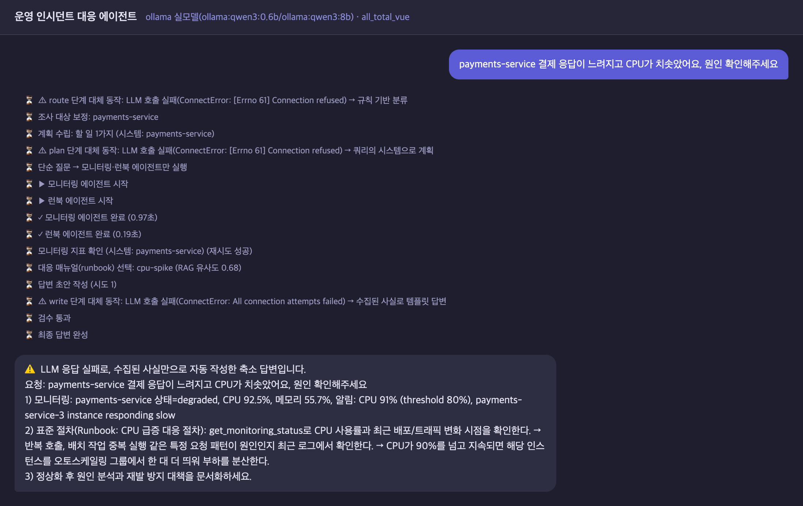
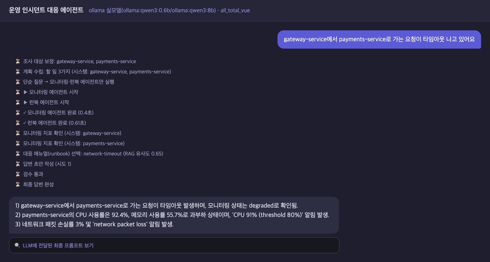
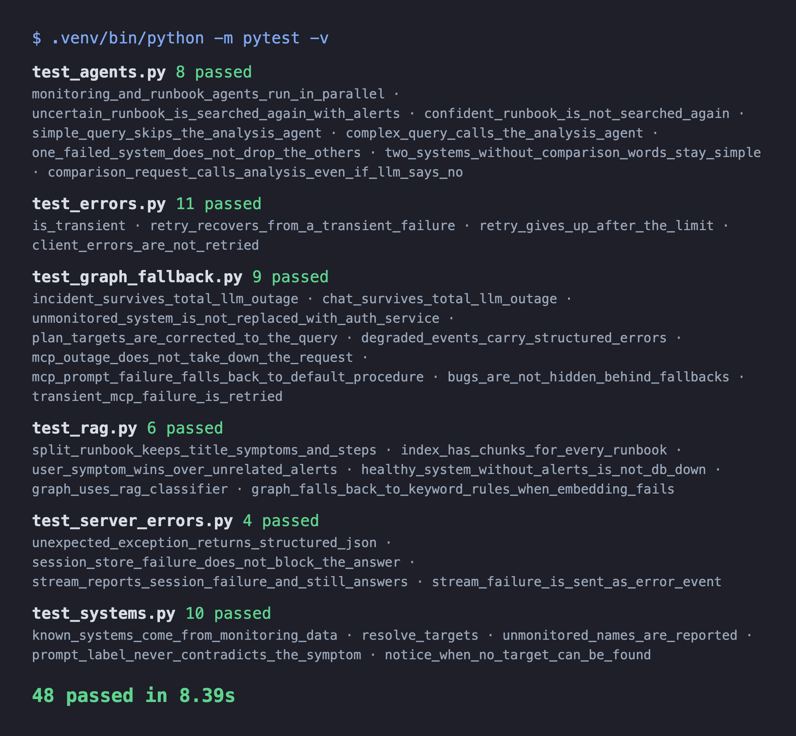
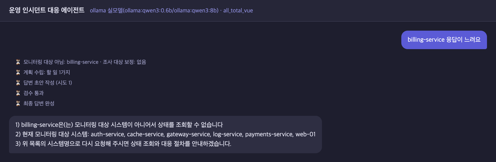
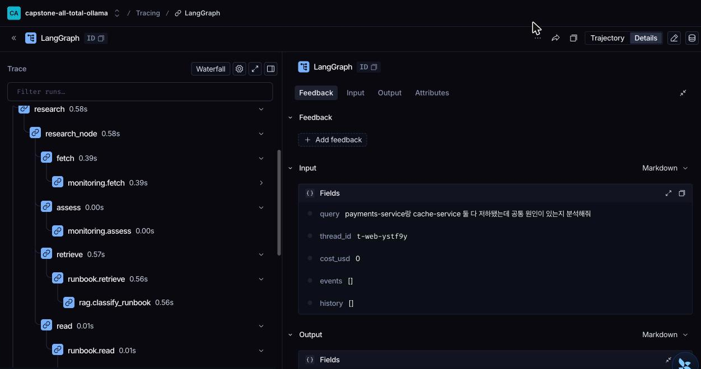
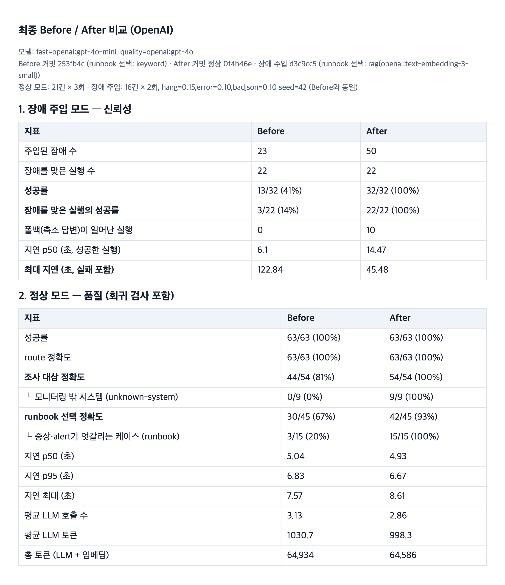

# 장애 진단 에이전트 — Multi-Agent 개선

SKALA AI Mini Project · 과제 1번 (Base AI Agent 기능 개선/추가)

LangGraph + MCP 기반 운영 장애 진단 에이전트(Base 코드)의 research 구간을 **전문 서브에이전트 3개**로
나누고, 엉뚱한 시스템을 진단하던 문제와 LLM 장애 시 요청이 멈추던 문제를 고쳤다. 효과는 같은 입력의
Before/After로 실측했다.

- 사용자 질문 → 모니터링 조회(MCP Tool) + 대응 절차(런북) 검색(RAG) → LLM 답변
- 질문 종류에 따라 필요한 에이전트만 동작하고, LLM이 응답하지 않아도 수집한 사실로 답한다

## 1. 준비물

| 항목 | 용도 | 필수 여부 |
|---|---|---|
| Python 3.11 | 실행 환경 (`sh/setup_venv.sh`가 `.venv` 생성) | 필수 |
| [Ollama](https://ollama.com) + `qwen3:0.6b` · `qwen3:8b` | 로컬 LLM (분류·계획 / 답변 작성) | 로컬 실행 시 |
| Ollama `nomic-embed-text` | 런북 RAG 임베딩 | 로컬 실행 시 |
| OpenAI API 키 | gpt-4o-mini · gpt-4o, `text-embedding-3-small` (**과금**) | OpenAI 실행 시 |
| LangSmith API 키 | 실행 trace 기록 | 선택 |

`.env.example`을 복사해 `.env`를 만들고 키를 넣는다 (`.env`는 커밋하지 않는다).

| 변수 | 설명 |
|---|---|
| `LANGCHAIN_TRACING_V2` · `LANGCHAIN_API_KEY` · `LANGCHAIN_PROJECT` | LangSmith 추적 |
| `OPENAI_API_KEY` | OpenAI 백엔드에서만 필요 |
| `OPENAI_FAST_MODEL` · `OPENAI_QUALITY_MODEL` | 기본 gpt-4o-mini · gpt-4o |

## 2. 실행 방법

```bash
bash sh/setup_venv.sh            # .venv 생성 + requirements 설치 (최초 1회)
cp .env.example .env             # LangSmith·OpenAI 키 입력
bash sh/setup_ollama.sh          # qwen3:0.6b / qwen3:8b
ollama pull nomic-embed-text     # RAG 임베딩 (Ollama 백엔드)
bash sh/run_agent_ollma.sh       # 백엔드 :8100 (OpenAI: sh/run_agent_openai.sh, 과금)
bash sh/run_frontend.sh          # 웹 채팅 :8600 (새 터미널)
```

브라우저에서 `http://localhost:8600` 접속. `run_agent_*.sh`는 기동할 때 `session.db`(대화 이력)를 지운다.

## 3. API (백엔드 :8100)

| 메서드 · 경로 | 설명 |
|---|---|
| `GET /health` | 서버 상태, 사용 중인 LLM·runbook 선택 방식(rag/keyword) |
| `GET /version` | 파이프라인 버전 (v1/v2) |
| `POST /chat` | 질문 1건 처리 → 최종 답변과 진행 이벤트를 한 번에 반환 |
| `GET /chat/stream` | 같은 처리를 SSE로 실시간 전송 (웹 UI가 사용) |

```bash
curl -s -X POST localhost:8100/chat -H 'Content-Type: application/json' \
     -d '{"message": "billing-service 응답이 느려요", "thread_id": "t1"}'
```

`/chat` 응답 형태 — 성공이든 실패든 항상 `ok`로 구분한다:

```json
{
  "ok": true,
  "reply": "1) billing-service은(는) 모니터링 대상 시스템이 아니어서 …",
  "error": null,
  "degraded": [{"stage": "write", "reason": "LLM 호출 실패(…) → 수집된 사실로 템플릿 답변", "error": {…}}],
  "events": [{"type": "RouteDecided", …}, {"type": "AgentCompleted", "agent": "monitoring", …}],
  "metadata": {"route": "incident", "degraded_count": 0, "request_timeout_s": 60, …}
}
```

- `degraded`: 외부 호출(LLM·MCP·임베딩)이 실패해 대체 동작을 한 단계 목록 (없으면 빈 목록)
- 실패 시: 외부 장애·시간 초과는 HTTP 503, 그 밖의 오류는 500 — 둘 다 `{"ok": false, "reply": null, "error": {…}}`
- `/chat/stream` 이벤트: `AgentStarted`, `AgentCompleted`, `TaskCompleted`, `Degraded`, `AnswerToken`(답변 토큰),
  `FinalAnswer`, `Error`, 마지막에 `[DONE]`

## 4. 설정

`.env.example` 참고. 단계별 timeout은 `agent/errors.py`의 `TIMEOUTS`.

| 변수 | 의미 | 기본값 |
|---|---|---|
| `LLM_BACKEND` | `fake` · `ollama` · `openai` (실행 스크립트가 지정) | fake |
| `REQUEST_TIMEOUT` | 요청 하나의 전체 시간 상한(초) | 60 |
| `RUNBOOK_CLASSIFIER` | `rag` 또는 `keyword`(baseline 규칙, 비교용) | rag |
| `RAG_QUERY_WEIGHT` / `RAG_MIN_MARGIN` | 사용자 질의 비중 / 재검색 기준(1·2위 유사도 차) | 0.8 / 0.01 |
| `OLLAMA_URL` | Ollama 주소 — 없는 주소로 기동하면 LLM 장애 상황 재현 | `http://127.0.0.1:11434/api/chat` |

## 5. 테스트 · 평가

```bash
.venv/bin/python3 -m pytest tests                                              # 단위 테스트 48개
.venv/bin/python3 eval/run_eval.py --label after --backend ollama --repeat 1   # 정상 모드
.venv/bin/python3 eval/run_eval.py --label after --backend ollama --mode chaos # 장애 주입 (--chaos-mcp-rate 0.3 으로 MCP 장애 추가)
.venv/bin/python3 eval/compare.py                                              # Before/After 표 (OpenAI 결과 기준)
```

## 6. 참고 문서

| 문서 | 내용 |
|---|---|
| [doc/README.md](doc/README.md) | Base 코드 설명 — 아키텍처, Wave 1~15 패턴 |
| [doc/manual_ollma.md](doc/manual_ollma.md) · [doc/manual_openai.md](doc/manual_openai.md) | 사용 예시 (로컬 / OpenAI) |
| [doc/regression_test_queries.md](doc/regression_test_queries.md) | base 회귀 테스트 쿼리 |
| [eval/README.md](eval/README.md) | 평가 도구 · 장애 주입 방식 |
| [output/final_comparison.md](output/final_comparison.md) | Before/After 전체 비교표 |

## 7. 문제 — baseline 실측

| 증상 | 원인 |
|---|---|
| 모르는 시스템을 물으면 auth-service를 진단 (OpenAI 0/9) | 시스템을 못 찾으면 `auth-service`로 바꾸는 하드코딩, 같은 함수가 3개 파일에 복사 |
| runbook 선택 정확도 67%, `web-01 CPU 급증` → db-down 절차 | 조사가 끝난 뒤 alert 문구 키워드로 선택 — 사용자 질의를 보지 않고, alert가 없으면 db-down |
| research 노드 하나가 모니터링·runbook 조회를 모두 담당 | runbook을 조사 뒤에 찾느라 거의 매번 재조사(replan) |
| LLM이 응답하지 않으면 302초 뒤 HTTP 500 (Ollama), 장애 주입 시 성공률 41% | LLM timeout 300초 1회, 재시도·예외 처리 없음, MCP 호출엔 timeout도 없음 |



## 8. 개선·추가 포인트

**개선 (기존 동작을 고친 것)**

| 항목 | Before | After |
|---|---|---|
| ① 에이전트 분리 | research 노드 1개 | 모니터링·런북·분석 서브에이전트(compiled subgraph) 3개, supervisor가 병렬 호출 (`agent/agents/`) |
| ② RAG 런북 선택 | alert 키워드 매칭, 없으면 db-down | 런북 에이전트가 질의 임베딩 유사도로 선택, 1·2위 차가 작으면 alert를 더해 1회 재검색 (`agent/rag.py`) |
| ③ 하드코딩 제거 | 모르는 시스템 → auth-service | 쿼리에 나온 시스템만 조사, 모니터링 대상이 아니면 안내 (`agent/systems.py`) |
| ④ 분석 필요 여부 판단 | LLM의 `needs_analysis`로 결정 — 소형 모델은 단순 조회에도 "분석 필요" | gate가 코드 규칙으로 확정: 시스템 2개 이상 + 비교 표현(공통·비교·둘 다 …)일 때만 분석 에이전트 호출, LLM 판단은 참고로만 기록 |

**추가 (원래 없던 것)**

| 항목 | 내용 |
|---|---|
| ⑤ 장애 대응 | 단계별 timeout → 일시 오류(timeout·연결 실패·5xx·429)만 지수 백오프 재시도 → 그래도 실패하면 대체 답변. 노드는 외부 호출 실패만 `try/except`로 잡고 버그는 숨기지 않음. 요청 전체 상한 60초 (`agent/errors.py`, `agent/fallback.py`) |
| ⑥ 평가·테스트 | 같은 입력 21건 + 장애 주입 16건(seed 고정)으로 Before/After 비교 (`eval/`), 단위 테스트 48개 (`tests/`) |



파란 노드 = 서브에이전트 · 초록 노드 = 역할을 바꾼 노드. LLM·MCP·임베딩 호출은 모두 timeout + 재시도 → 실패 시 대체 동작을 거친다.

## 9. 사용한 기술 요소

| 기술 | 이번에 한 것 |
|---|---|
| Multi-Agent | 모니터링·런북·분석 에이전트를 LangGraph 서브그래프로 분리, supervisor가 `asyncio.gather`로 병렬 호출, 실패는 에이전트 단위로 격리 |
| RAG | runbook 청크 임베딩 + incident_type 메타데이터, 질의(+alert) 코사인 유사도, 백엔드별 임베딩(nomic-embed-text / text-embedding-3-small) |
| MCP | (기존) 모니터링 = Tool, runbook 본문 = Resource, 진단 절차 = Prompt → 모든 호출에 timeout 5초 + 재시도 추가 |
| 의존성 주입 | (기존) `SupervisorDeps`로 LLM·MCP 주입 → retriever 추가, 테스트에서 가짜 LLM·MCP·임베더로 교체 |
| LangSmith | 노드·에이전트를 계층 trace로 기록, 대체 답변이 나간 run에 `degraded` 태그 |
| 모듈화 | `agent/agents/`(서브에이전트), `errors.py`(장애 처리), `systems.py`(시스템명 처리), `rag.py`, `fallback.py` |
| 단위 테스트 | pytest 48개 — 병렬 실행, 재검색 상한, 단순/복잡 판단, 일부 실패 격리, 재시도, 서버 오류 응답 |

## 10. Before / After (OpenAI 실측)

fast=`gpt-4o-mini`, quality=`gpt-4o` · Before=`253fb4c`(baseline) · After=정상 `0f4b46e` / 장애 주입 `d3c9cc5` ·
전체 표: [output/final_comparison.md](output/final_comparison.md)

| 구분 | 지표 | Before | After |
|---|---|---|---|
| 장애 대응 (장애 주입 16건×2회) | 성공률 | 41% (13/32) | **100%** (32/32) |
| | 장애를 맞은 실행의 성공률 | 14% (3/22) | **100%** (22/22) |
| | 최대 지연 | 122.8초 | **45.5초** |
| 정확도 (정상 21건×3회) | 조사 대상 정확도 | 81% | **100%** |
| | └ 모니터링 밖 시스템 | 0% | **100%** |
| | runbook 선택 정확도 | 67% | **93%** |
| 비용 | 지연 p50 | 5.0초 | 4.9초 |
| | 평균 LLM 호출 수 | 3.13회 | 2.86회 |
| | 총 토큰 (LLM + 임베딩) | 64,934 | 64,586 |

- 장애 주입: 호출 단위로 응답 없음 15%·503 10%·깨진 JSON 10%, 같은 seed로 Before/After의 같은 위치에 같은 장애
- 장애 주입 1차 측정은 78%였다 — 실패 7건 모두 write timeout(60초)이 요청 상한과 같아 생긴 시간 초과. timeout을
  실측 최대의 2~6배로 줄여 다시 측정했다(`d3c9cc5`). 정상 모드에서는 새 timeout에 걸린 호출이 없어 결과가 그대로 유효하다

<p>


</p>
<p>


</p>
<p>


</p>
<p>

</p>

## 11. 한계와 트레이드오프

| 선택 | 얻은 것 | 내준 것 |
|---|---|---|
| 재시도 | 장애 시 성공률 41 → 100% | 장애가 걸린 요청은 느려짐 (성공한 실행 p50 6.1 → 14.5초) |
| 대체 답변 | 500 없이 항상 답변 | 장애 주입 32건 중 10건은 LLM 분석 없는 축소 답변 |
| 에이전트 병렬 | 재조사 감소, LLM 호출 3.13 → 2.86회 | MCP 클라이언트가 세션 잠금으로 호출을 순차 처리 — 병렬 효과 제한 |
| RAG 런북 선택 | 정확도 67 → 93% | 임베딩 비용, 판단이 애매하면 재검색(63회 중 6회), 요청당 runbook 1개 |
| 질문 구분 규칙 | 단순 질문은 분석 생략 | 비교 표현 없이 물으면 복잡한 질문도 단순 처리 |
| 단순한 장애 대응 | 설명 가능한 코드(`errors.py` 82줄) | MCP 서버 프로세스가 죽으면 자동 재연결 없음(서버 재시작 필요) |

- 루프 상한: runbook 재검색 1회, validate 재작성 3회
- 소형 모델(Ollama qwen3:0.6b)은 시스템명이 없는 질의("로그인 응답이 느려요")에서 대상을 못 고르거나, 인사말을
  장애 문의로 분류하는 경우가 있다 (OpenAI에서는 정상)
- 대화 기억은 chat 경로만: thread별 이력을 SQLite(`session.db`)에 저장하고 일반 대화에서 최근 10턴을 참고한다.
  장애 진단 경로는 매번 현재 질문만으로 진단한다 ("아까 그 시스템"은 이어받지 못함)
- 평가 데이터셋 21건·직접 라벨링, 장애 비율은 실제보다 가혹한 조건

**추가 개선 방향**: LLM-as-Judge 답변 검증(할루시네이션), runbook 검색을 MCP Tool로 노출, MCP 자동 재연결

## 12. 디렉터리

```
agent/   graph.py (supervisor 그래프)  agents/ (monitoring · runbook · analysis)
         errors.py  fallback.py  systems.py  rag.py  ← 추가
         openai_llm.py  ollama_llm.py  deps.py  ← 수정
eval/    run_eval.py  chaos.py  compare.py  dataset.json  README.md
tests/   test_agents.py  test_errors.py  test_graph_fallback.py  test_rag.py
         test_systems.py  test_server_errors.py
output/  before_* / after_* 결과(JSON), final_comparison.md, captures/
doc/     README.md (Base 코드 설명), regression_test_queries.md, 사용자 매뉴얼
```

Git 태그: `before` — Before 측정 기준점(agent 코드는 baseline과 동일). `after` — 이전 방향(신뢰성 중심)의 OpenAI 측정 시점 기록.
