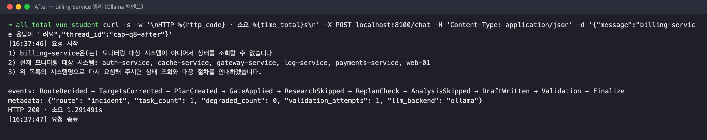
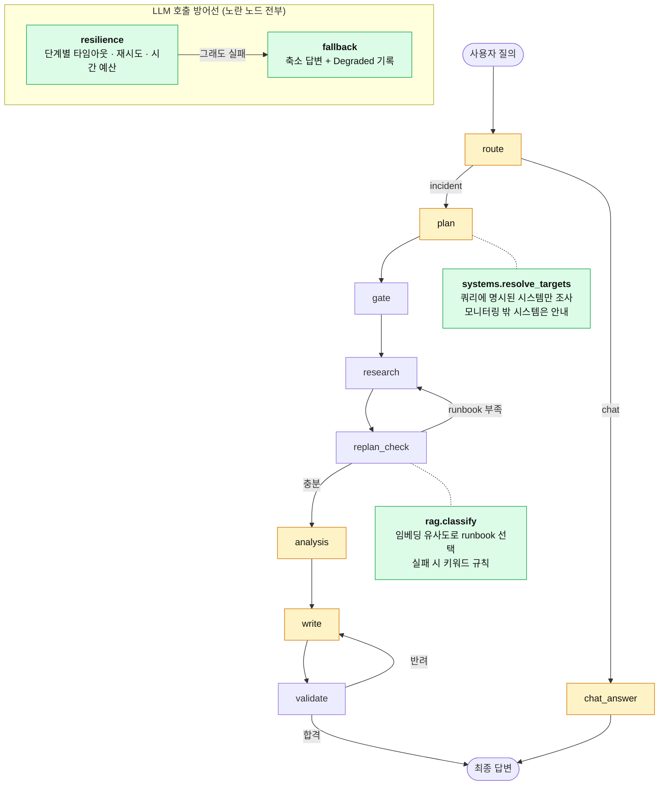
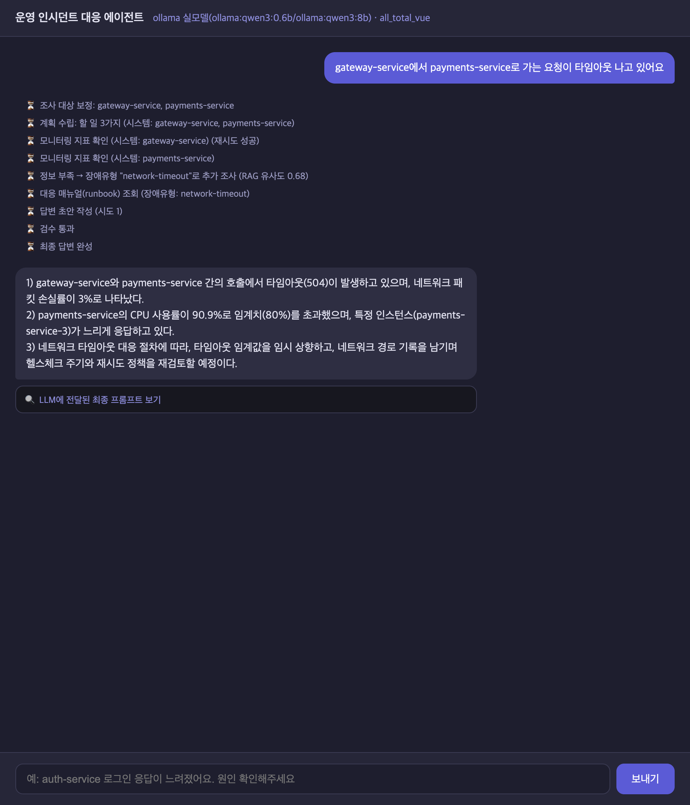
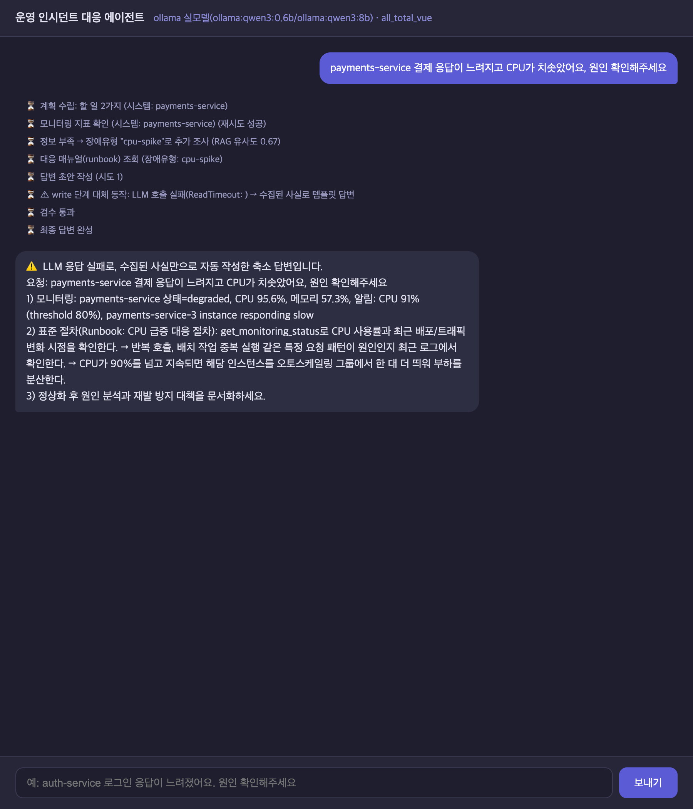

# 운영 인시던트 대응 에이전트 — 신뢰성(Reliability) 개선

SKALA AI Mini Project · 과제 1번 (Base AI Agent 기능 개선/추가)

LangGraph + MCP 기반 운영 장애 진단 에이전트(Base 코드)에서 **"모르는 시스템 이름 하나에 서버가
300초 멈추고 500 에러로 끝나는"** 문제를 출발점으로, LLM 호출이 실패하거나 엉뚱한 대상을 진단하는
약점을 고치고 그 효과를 같은 입력의 Before/After로 실측했다.

> Base 코드 설명(아키텍처, Wave 1~15 패턴, 실행 매뉴얼)은 [doc/README.md](doc/README.md) 참고.
> 진행 계획과 단계별 기록은 [doc/plan.md](doc/plan.md), 평가 도구 설명은 [eval/README.md](eval/README.md).

## 1. 문제 — baseline 실측

| 증상 | 원인 (코드에서 확인) |
|---|---|
| `billing-service 응답이 느려요` → **302초 후 HTTP 500** | 모르는 시스템명을 `auth-service`로 하드코딩 폴백 → MCP Prompt에 "시스템: auth-service / 증상: billing-service…" 모순 → qwen3 추론 모드가 thinking 루프(4000토큰 중 답변 0자) → 토큰 상한·추론 off·예외 처리가 모두 없어 timeout까지 대기 |
| LLM API가 응답하지 않거나 5xx면 요청 전체가 실패 | 재시도는 MCP 모니터링 조회 1곳에만 있고, LLM 호출 예외를 잡는 곳이 없음 |
| MCP 서버가 죽거나 응답하지 않으면 요청이 멈추거나 500 | MCP 호출에 타임아웃·예외 처리·세션 재연결이 없음 (프로세스를 죽이면 120초 넘게 멈춤) |
| 실패 응답에 형태가 없음 | `/chat`은 `Internal Server Error` 텍스트, `/chat/stream`은 연결이 조용히 끊김 |
| 모르는 시스템을 물어도 auth-service를 진단 (OpenAI 0/9) | `_guess_target` 등 같은 함수가 3개 파일에 복사돼 있고 모두 auth-service로 폴백 |
| `web-01 CPU 급증` → **db-down** 절차 안내 | runbook 선택이 alert 문구 키워드 매칭 — 사용자 증상을 보지 않고, alert가 없으면 db-down |

<p>


</p>

## 2. 개선·추가 포인트

**[개선] 기존 동작을 고친 것**

| 항목 | Before | After | 커밋 |
|---|---|---|---|
| 외부 호출 안정화 (LLM·MCP·임베딩) | LLM 호출당 timeout 300초/120초 1회, MCP는 타임아웃 없음 | 단계별 타임아웃·전체 시간 예산, 일시 오류만 지수 백오프+지터 재시도, `Retry-After` 존중, 서킷 브레이커, 추론 모드 off·출력 토큰 상한 (`agent/resilience.py`) | `c5d9f04`, 이후 보강 |
| 조사 대상 결정 | auth-service 하드코딩 폴백, 함수 3벌 복사 | `agent/systems.py`로 통합 — 쿼리에 명시된 시스템이 정답, 모니터링 밖 시스템은 조사하지 않고 안내 | `3a7162b` |
| RunBook 선택 | alert 키워드 매칭 (목록 순서 우선, 없으면 db-down) | **RAG** — runbook 청크 임베딩(incident_type 메타데이터) + 질의 0.8·alert 0.2 가중 유사도 (`agent/rag.py`) | `f585c7b` |

**[추가] 원래 없던 것**

| 항목 | 내용 | 커밋 |
|---|---|---|
| 실패 시 폴백 응답 | route·plan·analyze·write·chat 단계별 대체 동작, 500 대신 수집된 사실로 축소 답변 (`agent/fallback.py`) | `12a7cc7` |
| 구조화된 실패 | 재시도를 다 쓴 실패는 `ExternalCallError(error={stage, kind, retryable, attempts, elapsed_s, message})`, 노드는 `guard()`로 `CallResult(ok, value, error)`를 받아 분기. 버그(그 외 예외)는 폴백으로 숨기지 않음. `/chat`은 항상 `{ok, reply, error, degraded}`, 전역 예외 처리기·SSE `Error` 이벤트 | 이후 보강 |
| 요청 전체 deadline | 요청 하나가 쓸 수 있는 총시간(`REQUEST_DEADLINE`, 기본 60초)을 contextvar로 모든 외부 호출이 공유 — 넘기면 호출 없이 즉시 폴백, 느린 스트리밍도 끊음 | 이후 보강 |
| 세션 저장소 실패 격리 | SQLite 이력 조회·저장이 실패해도 이력 없이 진행하고 답변 반환, 실패는 `degraded`(stage=session)로 기록 | 이후 보강 |
| MCP 방어선 | 모든 MCP 호출(prompt·monitoring·runbook)에 타임아웃·재시도·서킷 브레이커, 실패 시 기본 절차·"조회하지 못했다" 안내. 세션이 끊기면 세대별 연결 task로 **자동 재연결** (`agent/mcp_client.py`) | 이후 보강 |
| 관측 | `Degraded` 이벤트, `/chat` metadata `degraded_count`, LangSmith run에 `degraded` 태그·원인 메타데이터, 웹 UI 단계 표시 | `12a7cc7` |
| 장애 주입 평가 | `eval/chaos.py` — 코드 수정 없이 httpx 전송 계층에서 응답 없음·503·깨진 JSON을 seed 고정으로 주입 | `6b73c78` |
| 평가·비교 도구 | `eval/run_eval.py`(정상/장애 주입), `eval/compare.py`(Before/After 표) | `6b73c78`, `743612d` |
| 단위 테스트 34개 | 의존성 주입(`SupervisorDeps`)으로 가짜 LLM·MCP·임베더를 넣어 장애 상황 검증 | `4a2d422`, `f585c7b` |
| 데이터 보강 | runbook에 한국어·영어 증상 키워드 한 줄, runbook 평가 케이스 5건 | `f585c7b` |



노란 노드 = LLM을 호출하는 노드(모두 resilience → fallback 방어선 적용) · 초록 노드 = 이번에 새로 추가한 모듈

## 3. 사용한 기술 요소

| 기술 | 적용 |
|---|---|
| RAG | runbook 청크 임베딩 + incident_type 메타데이터, 질의·alert 가중 코사인 유사도, 백엔드별 임베딩(nomic-embed-text / text-embedding-3-small) |
| MCP | Tool·Resource·Prompt 호출 전부에 방어선(타임아웃·재시도·폴백), 서버 프로세스가 죽으면 자동 재연결, Prompt의 `시스템:` 라벨이 증상과 모순되지 않도록 수정 |
| 의존성 주입 | `SupervisorDeps`에 retriever 추가, 테스트에서 가짜 LLM·MCP·임베더 주입 |
| LangSmith | 폴백 run에 `degraded` 태그·원인 메타데이터, 평가 실행을 `chat_request` 루트 run으로 기록 |
| 모듈화 | `resilience.py`·`fallback.py`·`systems.py`·`rag.py`로 관심사 분리, 중복 함수 3벌 제거 |
| 단위 테스트 | pytest 54개 (약 11초) — 재시도·서킷 브레이커·구조화된 실패·MCP 폴백·서버 오류 응답, MCP 프로세스 강제 종료 후 재연결(통합) |
| 장애 주입(Chaos) 테스트 | httpx 전송 계층 monkeypatch, 같은 seed로 Before/After 같은 위치에 같은 장애 |

## 4. Before / After (OpenAI 실측)

fast=`gpt-4o-mini`, quality=`gpt-4o` · Before=`before` 태그, After=`after` 태그 · 전체 표: [output/final_comparison.md](output/final_comparison.md)

| 구분 | 지표 | Before | After |
|---|---|---|---|
| 신뢰성 (장애 주입, 16건×2회, 같은 seed) | 성공률 | 41% (13/32) | **100%** (32/32) |
| | 장애를 맞은 실행의 성공률 | 14% (3/22) | **100%** (23/23) |
| | 최대 지연 (실패 포함) | 122.8초 | 98.9초 |
| 품질 (정상, 21건×3회) | 조사 대상 정확도 | 81% | **100%** |
| | └ 모니터링 밖 시스템 | 0% | **100%** |
| | runbook 선택 정확도 | 67% | **93%** |
| | └ 사용자 증상과 alert가 엇갈리는 경우 | 20% | **100%** |
| 비용 | 지연 p50 / 총 토큰 | 5.0초 / 64,934 | 5.7초 / 71,248 (+10%) |

- 장애 주입: 호출 단위로 응답 없음 15%·503 10%·깨진 JSON 10% (쿼리의 약 70%가 장애를 1번 이상 맞는 스트레스 조건)
- 장애 주입 모드의 "주입된 장애 수"는 After가 더 많다(23 → 53) — 재시도로 시도 자체가 늘어 더 많은 시도가 장애 판정을 받는다
- 단계별 기여(Ollama 점검): [doc/plan.md](doc/plan.md), `output/step*_*.md`

<p>


</p>

## 5. 한계와 트레이드오프

| 항목 | 내용 |
|---|---|
| 최대 지연 vs 답변 품질 | 요청 deadline(60초)으로 최대 지연을 115초 → 60초로 묶었지만(Ollama, LLM+MCP 장애), 시간이 끊긴 실행은 write가 템플릿 답변으로 대체돼 폴백 없이 성공한 비율이 52% → 43%로 내려감 |
| 타임아웃 기준 | httpx 타임아웃은 응답 조각 사이 대기 시간 기준 — 토큰이 계속 흘러오는 느린 스트리밍의 총 시간은 제한하지 못함 (웹 UI 캡처 중 실측) |
| 폴백 품질 | 서버는 죽지 않지만 장애 주입 시 11/32건이 축소 답변(LLM 분석 없이 수집값만) |
| RAG 비용·정확도 | 임베딩 호출로 p50 +0.6초·토큰 +10%, 요청당 runbook 1개만 선택(여러 증상 동시 대응 불가), "세 시스템 전부 느려졌어요"는 오분류. Ollama nomic 모델은 1·2위 점수 차가 0.002~0.005로 불안정 |
| 데이터 보강 | runbook 증상 키워드는 사람이 쓴 것 — runbook이 늘면 관리 비용, 키워드 편향 가능 |
| 추론 모드 off | 소형 모델(qwen3:0.6b)의 plan 품질 하락 — 대상 보정 규칙이 가려 주는 구조. 시스템명이 없는 질의는 추측 대신 되묻기 발생 |
| 평가의 한계 | 데이터셋 21건·직접 라벨링, 장애 비율은 실제보다 가혹, 모니터링 수치 jitter로 수치 인용 정확도는 미채점 |
| 남은 약점 | 30자+`1)`만 보는 validate(할루시네이션 미검출). 동기 LLM 호출은 `to_thread`로 옮겨 이벤트 루프는 막지 않지만 스레드를 점유 |
| 측정 시점 | 구조화된 실패·MCP 방어선·서킷 브레이커·요청 deadline·세션 실패 격리는 `after` 태그(OpenAI 최종 측정) **이후** 변경 — 위 OpenAI 수치에는 포함되지 않음. Ollama 점검: LLM+MCP 장애 54건 주입에도 21/21 성공, 예외 0건 (`output/step6-mcp_chaos_ollama.md`) |

**추가 개선 방향**: 비동기 LLM 호출, LLM-as-judge 검증, runbook 다중 선택·하이브리드 검색(BM25+임베딩), 장애 질의의 난이도별 분기

## 6. 실행 방법

```bash
bash sh/setup_venv.sh            # .venv 생성 + requirements 설치 (최초 1회)
cp .env.example .env             # LangSmith·OpenAI 키 입력
bash sh/setup_ollama.sh          # qwen3:0.6b / qwen3:8b
ollama pull nomic-embed-text     # RAG 임베딩 (Ollama 백엔드)
bash sh/run_agent_ollma.sh       # 백엔드 :8100 (OpenAI: sh/run_agent_openai.sh, 과금)
bash sh/run_frontend.sh          # 웹 채팅 :8600
```

평가·테스트:

```bash
.venv/bin/python3 -m pytest tests                                              # 단위 테스트 54개
.venv/bin/python3 eval/run_eval.py --label after --backend ollama --repeat 1   # 정상 모드
.venv/bin/python3 eval/run_eval.py --label after --backend ollama --mode chaos # 장애 주입 모드 (--chaos-mcp-rate 0.15 로 MCP 장애 추가)
.venv/bin/python3 eval/compare.py                                              # Before/After 표 (OpenAI 결과 기준)
```

주요 환경변수 (기본값은 `agent/resilience.py`, `agent/rag.py`):

| 변수 | 의미 | 기본값 |
|---|---|---|
| `LLM_TIMEOUT_<STAGE>` / `LLM_BUDGET_<STAGE>` | 단계(ROUTE·PLAN·ANALYZE·CHAT·WRITE·EMBED·MCP)별 시도당 타임아웃 / 재시도 포함 예산(초) | route 20/30, write 60/90, mcp 10/20 등 |
| `REQUEST_DEADLINE` | 요청 하나가 쓸 수 있는 총시간(초), 0이면 끔 | 60 |
| `CIRCUIT_FAILURES` / `CIRCUIT_COOLDOWN` | 서비스(llm·mcp·embed)별 연속 실패 몇 번에 차단할지 / 차단 시간(초) | 3 / 30 |
| `LLM_RETRIES`, `LLM_RETRY_BASE_DELAY` | 재시도 횟수, 백오프 시작 간격 | 2, 0.5 |
| `LLM_MAX_TOKENS_JSON` / `LLM_MAX_TOKENS_TEXT` | 출력 토큰 상한 | 512 / 1024 |
| `RUNBOOK_CLASSIFIER` | `rag` 또는 `keyword`(baseline 규칙, 비교용) | rag |
| `RAG_QUERY_WEIGHT` | RAG에서 사용자 질의 비중 (나머지는 alert) | 0.8 |

## 7. 디렉터리

```
agent/   resilience.py  fallback.py  systems.py  rag.py   ← 추가
         graph.py  openai_llm.py  ollama_llm.py  deps.py  mcp_client.py   ← 수정
eval/    run_eval.py  chaos.py  compare.py  dataset.json  README.md
tests/   test_resilience.py  test_systems.py  test_graph_fallback.py  test_rag.py
         test_mcp_reconnect.py  test_server_errors.py
output/  before_* / step*_* / after_* 결과(JSON·MD), final_comparison.md, captures/
doc/     plan.md (진행 계획·단계별 기록), README.md (Base 코드 설명)
```

Git 태그: `before` (Before 측정 기준점 — agent 코드는 baseline과 동일) · `after` (OpenAI 최종 측정 커밋)
